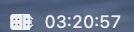
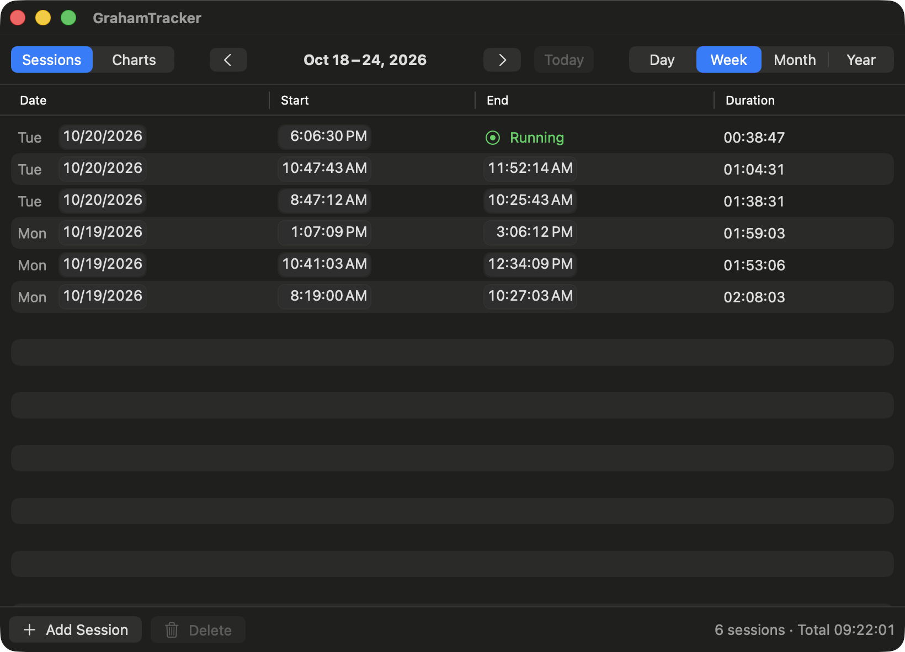
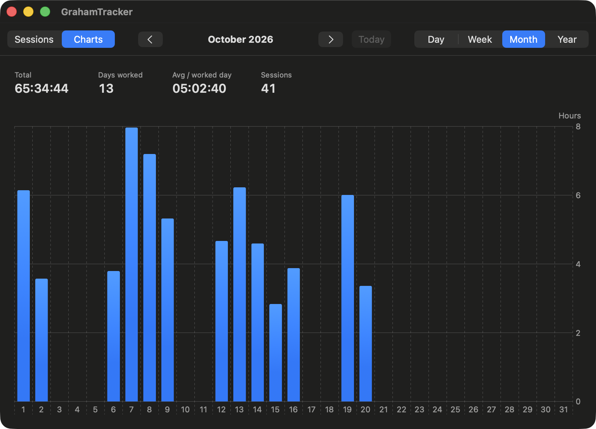
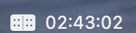
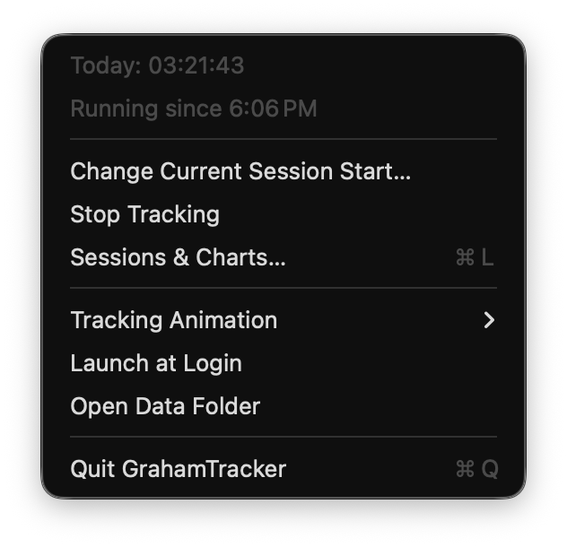
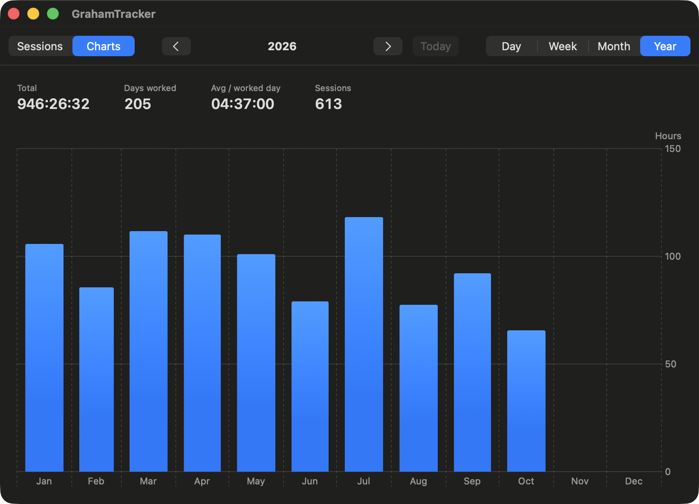
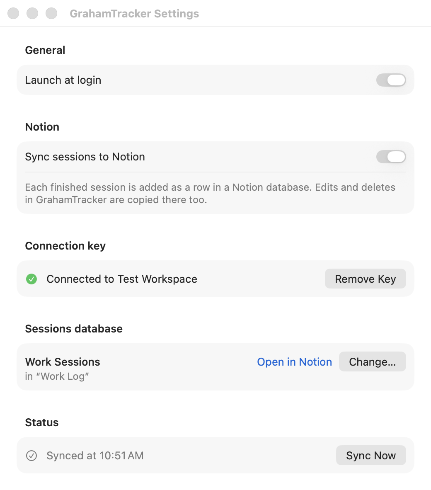

# GrahamTracker

A tiny, no-fuss work timer that lives in your Mac's menu bar.



There are no projects, tasks, or tags. You're either working or you're not. GrahamTracker shows how long you've worked today, keeps a log of every work session, and charts your hours over time.

## Features

- **Today's total in the menu bar**: always visible as `HH:MM:SS`.
- **One click to start or stop**: click the timer in the menu bar to toggle tracking.
- **Fun status icon**: a graham cracker when stopped, and a cracker being munched while you work (or twinkling sparkles if you prefer).
- **Editable session log**: every work session in a table. Fix start and end times, move sessions to another day, add sessions you forgot, or delete mistakes.
- **Charts**: see your hours by day, week, month, or year.
- **Auto-stop when you're away**: tracking stops on its own after 5 minutes with no keyboard or mouse activity, or when your Mac goes to sleep.
- **Starts with your Mac**: launches automatically when you log in (you can turn this off in Settings).
- **Optional Notion sync**: copy your sessions into a Notion database, so you can see them from anywhere, or let other tools and AI assistants that use your Notion read them.





## Install

**You'll need:** a Mac running macOS 14 (Sonoma) or later, and Apple's free Command Line Tools. If you've never installed the Command Line Tools, open Terminal and run:

```sh
xcode-select --install
```

**Then install GrahamTracker:**

```sh
git clone https://github.com/grahamcracker/grahamtracker.git
cd grahamtracker
make install
```

This builds the app, puts it in the `Applications` folder inside your home folder, and opens it. The cracker icon and `00:00:00` will appear in your menu bar. On first launch, GrahamTracker adds itself to your Login Items so it starts whenever you log in. macOS may show a notification about this.

**To update** to the latest version, run this from the same folder:

```sh
git pull
make install
```

Updating quits and restarts the app. If you were tracking, your session is saved, and you'll need to click to start again.

**To uninstall**, choose **Quit GrahamTracker** from its menu, then delete `GrahamTracker.app` from the `Applications` folder in your home folder. Your history is kept in `~/Library/Application Support/GrahamTracker`, so delete that folder too if you want to remove it.

## How it works

### The menu bar timer

The timer shows **how much you've worked today**, across all of today's sessions. It resets at midnight. If a session runs past midnight, the time is split between the two days.

- **Click** the timer to start tracking. Click again to stop.
- **Right-click** (or Control-click / Option-click) to open the menu.

The icon tells you at a glance whether you're tracking:

| Icon | Meaning |
| --- | --- |
|  | Stopped. A whole graham cracker. |
|  | Tracking. The cracker is being munched. |

### The menu



- **Today**: your total for today.
- **Status**: when the current session started, or why tracking last stopped automatically (for example, "Auto-stopped at 3:42 PM (idle 5 min)").
- **Change Current Session Start…**: shown only while tracking. Forgot to start the timer when you sat down? This opens the session log with the start time of your current session ready to edit. Type the time you actually started.
- **Start / Stop Tracking**: same as clicking the timer.
- **Sessions & Charts…** (⌘L): opens the session log and charts window.
- **Tracking Animation**: choose **Munching Cracker** (default), **Sparkles**, or **None** (a still icon).
- **Open Data Folder**: shows where your history is saved.
- **Settings…** (⌘,): turn **Launch at login** on or off, and set up Notion sync.
- **Notion status** and **Sync to Notion Now**: shown only when Notion sync is on.
- **Quit GrahamTracker**: quits the app. If you're tracking, the session is saved first.

### Sessions

A session is one stretch of work, from when you start the timer to when it stops. Sessions shorter than 5 seconds aren't saved, so an accidental double-click won't clutter your log.

### Automatic stopping

You don't have to remember to stop the timer when you walk away:

- **Away from your computer**: after **5 minutes** with no keyboard or mouse activity, tracking stops and the session is saved. Those 5 minutes are included in the session.
- **Mac goes to sleep**: tracking stops at the moment your Mac sleeps.

After an automatic stop, GrahamTracker stays stopped until you click to start again. The menu shows when and why it stopped.

If the app or your Mac shuts down unexpectedly while you're tracking, your session is saved up to the last 30 seconds or so before the shutdown.

### The Sessions & Charts window

Open it from the menu with **Sessions & Charts…** (⌘L).

At the top of the window:

- **Sessions / Charts** switches between the session log and the charts.
- **Day / Week / Month / Year** picks how much time to show. It applies to both tabs, and GrahamTracker remembers your choice.
- The **‹ ›** arrows move to the previous or next day, week, month, or year. **Today** jumps back to the current one.

### Session log

Every session in the selected time range is listed, newest first. A session in progress appears at the top, marked **Running**, with its duration counting up. The bottom of the window shows the number of sessions and the total time for the range.

**Editing a session:** click any date or time and type over it, or use the up and down arrow keys. Press Tab to move between hours, minutes, and seconds. Changes are saved immediately.

- **Date**: moves the whole session to another day, keeping its start and end times.
- **Start / End**: times are accurate to the second. If you set an end time earlier than the start time, GrahamTracker assumes the session ended the next day and shows **+1d** next to it.
- **The running session**: you can change its date and start time. It doesn't have an end time yet.

GrahamTracker won't accept an edit that would make a session end before it starts.

**Adding a session:** click **Add Session**, then set its date and times. Use this for work you forgot to track.

**Deleting sessions:** select one or more rows, then click **Delete**, press the Delete key, or right-click and choose **Delete**. GrahamTracker asks you to confirm first. Deleting the running session discards it without saving.

### Charts



The **Charts** tab shows a bar chart of your time for the selected range:

| Range | Each bar shows |
| --- | --- |
| Day | Minutes worked in each hour |
| Week | Hours worked each day |
| Month | Hours worked each day |
| Year | Hours worked each month |

Above the chart are totals for the range: **Total** time, **Days worked**, **Avg / worked day** (average time on the days you worked), and the number of **Sessions**. If you're tracking right now, the chart updates live.

### Keyboard shortcuts

In the Sessions & Charts window:

| Shortcut | Action |
| --- | --- |
| ⌘[ | Previous day / week / month / year |
| ⌘] | Next day / week / month / year |
| ⌘T | Jump to today |
| Delete | Delete the selected sessions |
| ⌘W | Close the window |

### Sync to Notion

GrahamTracker can copy your sessions into a Notion database. It's off by default. Turning it on is handy if you want your hours somewhere you can reach from your phone, share them, or let an assistant that's connected to your Notion answer questions like "how much did I work this week?"

You don't need to sign in to Notion on your Mac. GrahamTracker uses a connection key that can only see the one page you share with it.



**To set it up:**

1. Choose **Settings…** from the GrahamTracker menu and turn on **Sync sessions to Notion**.
2. Click **Open Notion connections…**, then **New integration**. Pick your workspace, leave the type as **Internal**, and save. Copy the **Internal Integration Secret** (it starts with `ntn_`). You don't need anything from the OAuth or "public integration" settings.
3. Paste the secret into GrahamTracker and click **Connect**.
4. In Notion, open the page where your sessions should live (or create a new one). Click **•••** in the top-right corner, choose **Connections**, and add the connection you just made.
5. Back in GrahamTracker, click the refresh button, choose that page, and click **Create Database**.

GrahamTracker creates a **Work Sessions** database on that page and fills it with your existing sessions. Each row has the session's **Start** and **End** time and its length in **Hours**.

**After that, it keeps itself up to date:**

- New sessions are added a few seconds after they end. A session in progress isn't added until it stops.
- If you edit a session in GrahamTracker, its row in Notion is updated.
- If you delete a session in GrahamTracker, its row is moved to Notion's trash.
- Syncing only goes one way. Changes you make in Notion aren't copied back, and may be overwritten if you later edit that session in GrahamTracker.
- If you're offline or Notion is down, GrahamTracker tries again every few minutes. The menu shows the last time it synced, or what went wrong.

**To stop syncing,** turn off the switch in Settings. Your Notion database stays as it is. **Remove Key** disconnects GrahamTracker from Notion entirely. **Change…** lets you create a new database on a different page.

The key is saved in GrahamTracker's data folder, in a file only your Mac account can read.

### Your data

Your history stays on your Mac, in `~/Library/Application Support/GrahamTracker/sessions.json`. Choose **Open Data Folder** from the menu to find it.

- GrahamTracker saves a backup copy, `sessions.backup.json`, each time it starts.
- The file is plain text and readable, so you can edit it by hand. **Quit GrahamTracker first**, or your changes may be overwritten.
- If GrahamTracker can't read the file (for example, after a hand-edit typo), it won't overwrite it. It renames the file to `sessions.broken-….json`, tells you, and starts fresh. Fix the file, rename it back to `sessions.json` with the app quit, and reopen GrahamTracker.
